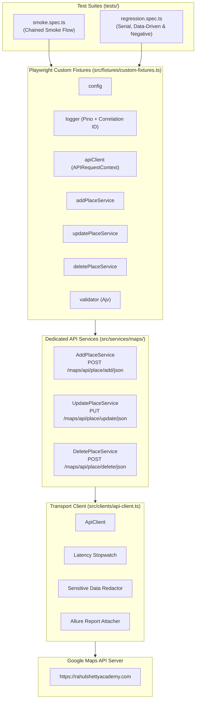
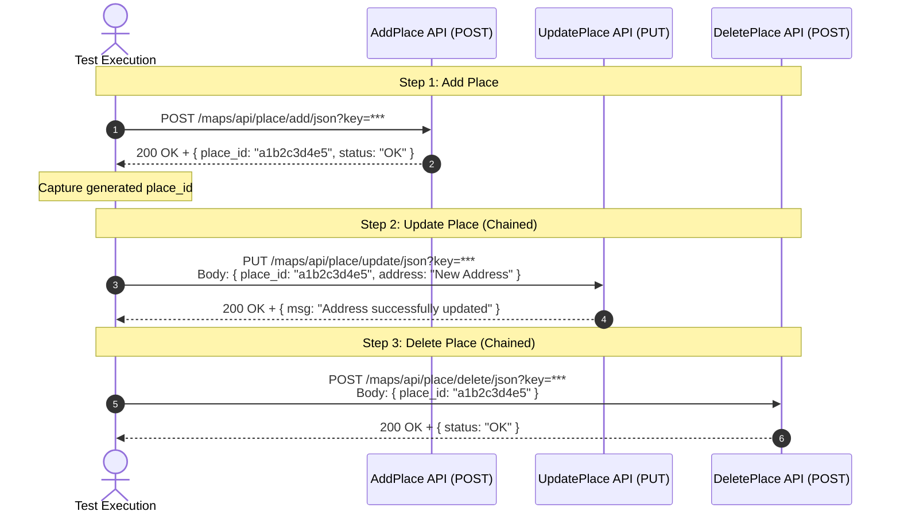

# Enterprise Google Maps API Automation Framework (Playwright & TypeScript)

[](https://github.com/SatyaDevCheekatla/MapsAPI_Playwright_Framework/actions/workflows/api-tests.yml)
[](https://www.typescriptlang.org/)
[](https://playwright.dev/)
[](https://allurereport.org/)
[](https://prettier.io)

An enterprise-grade, robust, and maintainable API automation framework designed for high scalability, parallel execution, and continuous integration. Migrated from a legacy Java / REST Assured / Cucumber / ExtentReports architecture to modern **Playwright**, **TypeScript (Strict Mode)**, **Ajv Schema Validation**, and **Allure Reporting**.

---

## Table of Contents
1. [Framework Architectural Overview](#1-framework-architectural-overview)
2. [The Interlinked 3-API Workflow](#2-the-interlinked-3-api-workflow)
3. [Complete Folder and File Structure](#3-complete-folder-and-file-structure)
4. [Deep-Dive File, Class & Component Reference](#4-deep-dive-file-class--component-reference)
   - [Root Configuration Files](#a-root-configuration-files)
   - [Configuration Module (`config/`)](#b-configuration-module-config)
   - [HTTP Transport Client (`src/clients/`)](#c-http-transport-client-srcclients)
   - [Domain Service Layer (`src/services/`)](#d-domain-service-layer-srcservices)
   - [Custom Fixtures & Dependency Injection (`src/fixtures/`)](#e-custom-fixtures--dependency-injection-srcfixtures)
   - [Validation Layer (`src/validators/`)](#f-validation-layer-srcvalidators)
   - [Observability & Structured Logging (`src/utils/`)](#g-observability--structured-logging-srcutils)
   - [Strongly Typed Models (`src/models/`)](#h-strongly-typed-models-srcmodels)
   - [Test Data & Schemas (`src/data/`)](#i-test-data--schemas-srcdata)
   - [Test Suites (`tests/`)](#j-test-suites-tests)
   - [CI/CD Workflows (`.github/workflows/`)](#k-cicd-workflows-githubworkflows)
   - [Execution Scripts (`scripts/`)](#l-execution-scripts-scripts)
5. [Configuring in Visual Studio Code (VS Code)](#5-configuring-in-visual-studio-code-vs-code)
6. [Commands to Run the Framework](#6-commands-to-run-the-framework)

---

## 1. Framework Architectural Overview



### Core Architecture Principles:
- **Zero Global Mutable State**: No static Singletons (`ScenarioContext`) or `ThreadLocal` storage. Every test runs in complete isolation.
- **Pure Dependency Injection**: Test classes declare what they require (`addPlaceService`, `updatePlaceService`, `deletePlaceService`, `validator`), and Playwright's `test.extend()` provisions them.
- **Transport Separation**: Services do not construct raw HTTP requests or headers. All network operations pass through [`ApiClient`](src/clients/api-client.ts).
- **Automated Observability**: Every request has an ISO timestamp, latency in ms, correlation ID (`X-Correlation-ID`), and automatic masking of secrets (`?key=***REDACTED***`).
- **Strict Typing**: 100% strict TypeScript. No `any` types; all request payloads and response bodies have TypeScript interfaces.

---

## 2. The Interlinked 3-API Workflow

The framework centers on three tightly coupled, sequential APIs:



1. **`AddPlace API`**: Creates a location entry on the server. The response payload returns a unique `place_id`.
2. **`UpdatePlace API`**: Consumes the `place_id` produced in Step 1 to update the street address.
3. **`DeletePlace API`**: Consumes the same `place_id` to purge the record from the server, completing the lifecycle and ensuring zero leftover test data.

---

## 3. Complete Folder and File Structure

```text
Playwright-Maps-API/
├── .github/
│   └── workflows/
│       └── api-tests.yml              # GitHub Actions CI/CD matrix pipeline
├── .vscode/
│   ├── extensions.json                # Recommended VS Code plugins
│   ├── launch.json                    # VS Code interactive debug configurations
│   └── settings.json                  # VS Code formatting, ESLint & test settings
├── config/
│   └── config.ts                      # Zod-validated environment config & secret redactor
├── reports/
│   ├── emailable-report.html          # Self-contained emailable HTML report (100% offline, zero CORS)
│   └── index.html                     # Web-ready mirror of emailable report
├── scripts/
│   ├── generate-emailable-report.js   # Standalone HTML report generator script
│   ├── run-npm.cmd                    # Windows CMD helper for npm execution
│   ├── run-npx.cmd                    # Windows CMD helper for npx execution
│   └── run-tests.ps1                  # PowerShell helper for running suites
├── src/
│   ├── clients/
│   │   └── api-client.ts              # Core HTTP client wrapping Playwright APIRequestContext
│   ├── constants/
│   │   └── endpoints.ts               # Endpoint URLs and HTTP status constants
│   ├── data/
│   │   ├── factories/
│   │   │   └── place-data.factory.ts  # Collision-free dynamic test data generator
│   │   ├── schemas/                   # Ajv Draft-07 JSON Schemas
│   │   │   ├── add-place-schema.json
│   │   │   ├── update-location-schema.json
│   │   │   ├── delete-place-schema.json
│   │   │   └── error-schema.json
│   │   └── static/                    # Baseline static JSON data
│   │       ├── default-place.json
│   │       └── update-place.json
│   ├── fixtures/
│   │   └── custom-fixtures.ts         # Custom Playwright fixtures (test.extend)
│   ├── models/
│   │   ├── common/
│   │   │   └── api-response.model.ts  # ApiResponse<T> and ApiErrorResponse interfaces
│   │   ├── requests/
│   │   │   └── maps-requests.model.ts # Typed request DTOs
│   │   ├── responses/
│   │   │   └── maps-responses.model.ts# Typed response DTOs
│   │   └── index.ts                   # Models barrel export
│   ├── reporters/
│   │   └── emailable-reporter.ts      # Custom Playwright reporter generating emailable HTML
│   ├── services/
│   │   ├── maps/
│   │   │   ├── add-place.service.ts   # Dedicated service for Add Place API
│   │   │   ├── update-place.service.ts# Dedicated service for Update Place API
│   │   │   └── delete-place.service.ts# Dedicated service for Delete Place API
│   │   └── index.ts                   # Services barrel export
│   ├── utils/
│   │   └── logger.ts                  # Pino structured correlation-aware logger
│   └── validators/
│       └── api-validator.ts           # Centralized Ajv schema & assertion validator
├── tests/
│   ├── smoke.spec.ts                  # Smoke Test Class: Chained critical path
│   └── regression.spec.ts             # Regression Test Class: Serial, Data-Driven & Negative
├── .env                               # Active local environment variables
├── .env.example                       # Environment variables template
├── .eslintrc.json                     # ESLint static code analysis rules
├── .gitignore                         # Git ignored files & directories
├── .prettierrc                        # Prettier code formatting rules
├── package.json                       # Dependencies, metadata & script commands
├── playwright.config.ts               # Playwright test runner configuration
├── README.md                          # Comprehensive framework documentation
└── tsconfig.json                      # TypeScript strict compiler configuration
```

---

## 4. Deep-Dive File, Class & Component Reference

### A. Root Configuration Files

#### `playwright.config.ts`
- **Purpose**: Central configuration for the Playwright Test runner.
- **Key Settings**:
  - `testDir: './tests'`: Specifies test location.
  - `fullyParallel: true`: Executes test files in parallel across worker processes.
  - `workers`: Dynamic worker pool configuration (configurable via `process.env.WORKERS`).
  - `retries`: Set to `2` on CI environments, `0` locally.
  - `reporter`: Emits terminal console logs and feeds data to `allure-playwright` with environment metadata (`NODE_VERSION`, `ENVIRONMENT`, `BASE_URL`).

#### `tsconfig.json`
- **Purpose**: Defines TypeScript compilation rules.
- **Key Settings**:
  - `target: "ES2022"`, `module: "NodeNext"`, `moduleResolution: "NodeNext"`.
  - `strict: true`, `noImplicitAny: true`, `strictNullChecks: true`.
  - Path mappings: `"@/*": ["src/*"]`, `"@config/*": ["config/*"]`.

#### `package.json`
- **Purpose**: Defines dependencies, metadata, and script shortcuts.
- **Dependencies**:
  - `@playwright/test`: Core test runner and API request engine.
  - `ajv` & `ajv-formats`: High-speed JSON schema validation.
  - `allure-playwright` & `allure-js-commons`: Reporting adapter.
  - `pino` & `pino-pretty`: High-performance structured logger.
  - `zod`: Runtime configuration schema validation.
  - `dotenv`: Loads `.env` file variables into `process.env`.

#### `.env.example` & `.env`
- **Purpose**: Stores runtime variables (Base URL, API keys, log level, timeouts).
- **Variables**:
  - `BASE_URL`: Root API endpoint (`https://rahulshettyacademy.com`).
  - `MAPS_API_KEY`: Authentication query parameter (`qaclick123`).
  - `API_TIMEOUT`: Maximum HTTP timeout in milliseconds (`30000`).
  - `ENVIRONMENT`: `development` | `qa` | `staging`.
  - `LOG_LEVEL`: `trace` | `debug` | `info` | `warn` | `error`.
  - `WORKERS`: Worker threads count for parallel execution (`2`).

---

### B. Configuration Module (`config/`)

#### `config/config.ts`
- **Classes / Functions**:
  - `configSchema`: Zod schema validating presence and formats of environment variables.
  - `loadConfig()`: Validates `process.env` at bootstrap; halts immediately with descriptive error if configuration is missing.
  - `redactSensitiveData(content: unknown)`: Recursive utility function that sanitizes secrets (`key`, `password`, `token`, `secret`) with `***REDACTED***` before logging or attaching to Allure.
  - `config`: Exported immutable singleton object containing typed configuration.

---

### C. HTTP Transport Client (`src/clients/`)

#### `src/clients/api-client.ts`
- **Interface**: `IApiClient`
- **Class**: `ApiClient implements IApiClient`
- **Responsibilities**:
  - Encapsulates Playwright's `APIRequestContext.fetch()`.
  - Implements `get<T>`, `post<T>`, `put<T>`, `patch<T>`, and `delete<T>`.
  - Generates and attaches `X-Correlation-ID` header.
  - Tracks response duration via high-resolution timer (`Date.now()`).
  - Logs structured request/response events via `TestLogger`.
  - Automatically attaches masked HTTP request and response payloads to the Allure report via `allure.attachment()`.
  - Returns a strongly typed `ApiResponse<T>`.

---

### D. Domain Service Layer (`src/services/`)

#### `src/services/maps/add-place.service.ts`
- **Class**: `AddPlaceService`
- **Method**:
  - `addPlace(payload: AddPlaceRequest, apiKey?: string): Promise<ApiResponse<AddPlaceResponse>>`
  - Sends `POST /maps/api/place/add/json?key=<apiKey>`.

#### `src/services/maps/update-place.service.ts`
- **Class**: `UpdatePlaceService`
- **Method**:
  - `updatePlace(payload: UpdatePlaceRequest, queryApiKey?: string): Promise<ApiResponse<UpdatePlaceResponse>>`
  - Sends `PUT /maps/api/place/update/json?key=<apiKey>`.

#### `src/services/maps/delete-place.service.ts`
- **Class**: `DeletePlaceService`
- **Method**:
  - `deletePlace(placeId: string, apiKey?: string): Promise<ApiResponse<DeletePlaceResponse>>`
  - Sends `POST /maps/api/place/delete/json?key=<apiKey>` with `{ place_id: placeId }`.

#### `src/services/index.ts`
- **Purpose**: Barrel export file exposing all 3 services cleanly.

---

### E. Custom Fixtures & Dependency Injection (`src/fixtures/`)

#### `src/fixtures/custom-fixtures.ts`
- **Exports**: `test` (extended from Playwright's `baseTest`), `expect`.
- **Fixtures Provided to Tests**:
  - `config`: Loaded environment configuration.
  - `correlationId`: Unique UUID generated per test case.
  - `logger`: `TestLogger` instance bound to the test name and `correlationId`.
  - `apiClient`: Clean `ApiClient` instance backed by Playwright's `request` context.
  - `validator`: Pre-compiled `ApiValidator` instance.
  - `addPlaceService`: Instantiated `AddPlaceService`.
  - `updatePlaceService`: Instantiated `UpdatePlaceService`.
  - `deletePlaceService`: Instantiated `DeletePlaceService`.
  - `createdPlace`: Auto-cleanup fixture. Creates a place in setup, yields `{ placeId, requestPayload }`, and deletes it in teardown (`finally`).

---

### F. Validation Layer (`src/validators/`)

#### `src/validators/api-validator.ts`
- **Class**: `ApiValidator`
- **Methods**:
  - `validateStatusCode(response: ApiResponse<unknown>, expectedStatus: number)`: Asserts response status code with descriptive message.
  - `validateResponseTime(response: ApiResponse<unknown>, maxDurationMs: number)`: Enforces SLA response times.
  - `validateHeader(response: ApiResponse<unknown>, headerName: string, pattern: string | RegExp)`: Asserts response headers.
  - `validateSchema(response: ApiResponse<unknown>, schemaName: SchemaName)`: Validates body against compiled Ajv schemas (`addPlace`, `updatePlace`, `deletePlace`, `error`).
  - `validateBodyProperty<T>(response: ApiResponse<Record<string, unknown>>, path: string, expectedValue: T)`: Deep path assertion.

---

### G. Observability & Structured Logging (`src/utils/`)

#### `src/utils/logger.ts`
- **Interface**: `ITestLogger`
- **Class**: `TestLogger implements ITestLogger`
- **Responsibilities**:
  - Built on **Pino** for JSON structured logging.
  - Injects `testName`, `correlationId`, `hostname`, `pid`, and ISO timestamp into every log line.
  - Masks sensitive keys (`key`, `password`, `token`) before serializing.
  - Exposes `info()`, `debug()`, `warn()`, `error()`, and `fatal()`.

---

### H. Strongly Typed Models (`src/models/`)

#### `src/models/requests/maps-requests.model.ts`
- **Interfaces**:
  - `LocationCoordinates`: `{ lat: number; lng: number; }`
  - `AddPlaceRequest`: Full payload for Add Place API (`location`, `accuracy`, `name`, `phone_number`, `address`, `types`, `website`, `language`).
  - `UpdatePlaceRequest`: Payload for Update Place API (`place_id`, `address`, `key`).
  - `DeletePlaceRequest`: Payload for Delete Place API (`place_id`).

#### `src/models/responses/maps-responses.model.ts`
- **Interfaces**:
  - `AddPlaceResponse`: `{ status: string; place_id: string; scope: string; reference: string; id: string; }`
  - `UpdatePlaceResponse`: `{ msg: string; }`
  - `DeletePlaceResponse`: `{ status: string; }`

#### `src/models/common/api-response.model.ts`
- **Interfaces**:
  - `ApiResponse<T>`: Wraps HTTP status, headers, parsed data (`T`), raw text, duration in ms, URL, and correlation ID.
  - `ApiErrorResponse`: Generic error structure (`{ msg?: string; error?: string; }`).

---

### I. Test Data & Schemas (`src/data/`)

#### `src/data/factories/place-data.factory.ts`
- **Class**: `PlaceDataFactory`
- **Methods**:
  - `createValidAddPlacePayload(overrides?)`: Generates randomized coordinates, addresses, and names with timestamps to ensure collision-free parallel runs.
  - `getStaticAddPlacePayload()`: Returns baseline matching legacy `AddPlace.json`.
  - `createValidUpdatePlacePayload(placeId, overrides?)`: Generates update payloads.
  - `createInvalidPayload(scenario)`: Generates invalid/malformed payloads for negative testing.

#### `src/data/schemas/`
- `add-place-schema.json`: JSON Schema (Draft-07) for `AddPlaceResponse`.
- `update-location-schema.json`: JSON Schema for `UpdatePlaceResponse`.
- `delete-place-schema.json`: JSON Schema for `DeletePlaceResponse`.
- `error-schema.json`: JSON Schema for 404/Error responses.

#### `src/data/static/`
- `default-place.json`: Legacy static JSON payload baseline.
- `update-place.json`: Legacy static update payload baseline.

---

### J. Test Suites (`tests/`)

#### `tests/smoke.spec.ts` (Smoke Test Suite)
- **Class/Suite**: `Maps API - Smoke Test Suite`
- **Test Case**: `SMOKE-001: End-to-End Interlinked Workflow (AddPlace -> UpdatePlace -> DeletePlace)`
- **Behavior**:
  - Calls `AddPlace API` $\rightarrow$ verifies 200, checks schema, extracts `place_id`.
  - Calls `UpdatePlace API` using extracted `place_id` $\rightarrow$ verifies address updated message.
  - Calls `DeletePlace API` using extracted `place_id` $\rightarrow$ verifies status `"OK"`.

#### `tests/regression.spec.ts` (Regression Test Suite)
- **Class/Suite**: `Maps API - Regression Test Suite`
- **Scenarios Covered**:
  1. **Serial Pipeline (`test.describe.serial`)**:
     - `Step 1`: Creates place and captures `place_id`.
     - `Step 2`: Updates place address using Step 1 `place_id`.
     - `Step 3`: Deletes place using Step 1 `place_id`.
     - `Step 4`: Re-deletes place to verify API returns `404 Not Found` (confirming deletion).
  2. **Data-Driven 3-API Chains**:
     - Parameterized execution across French, Japanese, and US locale datasets.
  3. **Negative Edge Cases**:
     - Update Place with invalid ID $\rightarrow$ `404 Not Found`.
     - Delete Place with invalid ID $\rightarrow$ `404 Not Found`.
     - Delete Place with empty string `""` ID $\rightarrow$ `404 Not Found`.

---

### K. CI/CD Workflows (`.github/workflows/`)

#### `.github/workflows/api-tests.yml`
- **Triggers**:
  - Git `push` and `pull_request` on `master` and `main`.
  - `workflow_dispatch`: Manual trigger with suite selection dropdown (`full`, `smoke`, `regression`) and environment dropdown (`development`, `qa`, `staging`).
- **Steps**:
  - Node.js 22 setup with dependency caching.
  - Dependency install via `npm ci`.
  - TypeScript validation (`npm run typecheck`).
  - ESLint verification (`npm run lint`).
  - Parallel Playwright test execution.
  - Allure HTML report generation.
  - Artifact archiving (test results and Allure reports uploaded with 14–30 days retention).

---

### L. Execution Scripts (`scripts/`)

- `scripts/run-tests.ps1`: Cross-platform PowerShell script to run `smoke`, `regression`, or `full` suites.
- `scripts/run-npm.cmd`: Windows batch wrapper ensuring correct runtime PATH.
- `scripts/run-npx.cmd`: Windows batch wrapper for `npx` commands.

---

## 5. Configuring in Visual Studio Code (VS Code)

The repository includes pre-configured `.vscode/` settings for seamless development and debugging.

### Step 1: Open the Project in VS Code
Launch VS Code and open the root folder:
```bash
code "c:\my  projects\Playwright-Maps-API"
```

### Step 2: Install Recommended Extensions
When prompted by VS Code, click **Install All Recommended Extensions**, or install them via the Extensions panel (`Ctrl + Shift + X`):
1. **Playwright Test for VSCode** (`ms-playwright.playwright`) – Provides the native Playwright Test Explorer panel and inline green run buttons.
2. **ESLint** (`dbaeumer.vscode-eslint`) – Provides real-time TypeScript linting warnings.
3. **Prettier - Code formatter** (`esbenp.prettier-vscode`) – Formats code automatically on file save.

### Step 3: Run & Debug Tests Visually in VS Code
1. Open the **Testing Explorer** panel from the left sidebar (icon with a beaker / flask).
2. You will see both test classes:
   - `smoke.spec.ts`
   - `regression.spec.ts`
3. Click the **Play button** next to any test or suite to run it directly inside VS Code.
4. **Interactive Breakpoint Debugging**:
   - Set a breakpoint by clicking to the left of any line of code.
   - Right-click the test in the Test Explorer and select **Debug Test**, or press `F5` and select:
     - `Playwright: Debug Smoke Suite`
     - `Playwright: Debug Regression Suite`
     - `Playwright: Debug Current File`

---

## 6. Commands to Run the Framework

All commands can be executed from the terminal in the project root:

### A. Test Execution Commands

| Command | Action | Description |
| :--- | :--- | :--- |
| `npm test` | **Run All Tests** | Runs both Smoke and Regression suites in parallel with list reporter |
| `npm run test:smoke` | **Run Smoke Suite** | Executes only the critical 3-API chained path (`tests/smoke.spec.ts`) |
| `npm run test:regression` | **Run Regression Suite** | Executes serial steps, data-driven tests, and negative tests (`tests/regression.spec.ts`) |
| `npm run test:ci` | **Run CI Headless** | Executes tests with Allure results generation and CI line reporter |

### B. PowerShell Helper Commands (Windows)

```powershell
# Run all tests
.\scripts\run-tests.ps1

# Run only smoke suite
.\scripts\run-tests.ps1 -Suite smoke

# Run only regression suite
.\scripts\run-tests.ps1 -Suite regression
```

### C. Quality, Formatting & Type-Checking Commands

| Command | Action | Description |
| :--- | :--- | :--- |
| `npm run typecheck` | **TypeScript Type Check** | Validates compilation with zero emitted files (`tsc --noEmit`) |
| `npm run lint` | **Lint Check** | Inspects code quality with ESLint rules |
| `npm run format` | **Format Code** | Auto-formats all `.ts` and `.json` files via Prettier |
| `npm run format:check` | **Check Formatting** | Verifies code conforms to formatting standards |
| `npm run clean` | **Clean Artifacts** | Purges `test-results/`, `allure-results/`, and `allure-report/` |

### D. Emailable Report Commands (100% Offline & Shareable)

The framework includes a standalone, self-contained single-file HTML reporter that can be emailed as an attachment or opened directly by double-clicking in Windows Explorer. It has **zero external CSS/JS/fonts**, **zero CORS restrictions**, and requires **no web server**:

| Command | Action | Description |
| :--- | :--- | :--- |
| `npm run report:emailable` | **Generate Emailable Report** | Generates standalone HTML report with latest run data under `reports/` |
| `npm run report:open` | **Open Report in Browser** | Opens `reports/emailable-report.html` directly in your default browser |

```powershell
# Generate emailable report from latest run
npm run report:emailable

# Open the emailable report directly in default browser
npm run report:open

# PowerShell helper with auto-open
.\scripts\run-tests.ps1 -OpenReport
```

> **Email Attachment Guide**: To share with stakeholders or attach to CI emails, simply attach the single file located at `reports/emailable-report.html`. The recipient can double-click it in Windows Explorer or open it in any desktop/mobile browser to view the interactive test execution summary, metrics donut chart, suite breakdowns, and full HTTP request/response payloads without blank screen or CORS issues!

### E. Standard Allure Reporting Commands

To generate and inspect standard multi-page Allure reports with local web server:

```bash
# 1. Run tests to generate fresh allure-results
npm run test:ci

# 2. Generate the HTML report from results
npx allure generate allure-results --clean -o allure-report

# 3. Open the Allure Report in your default browser (requires local server)
npx allure open allure-report
```
